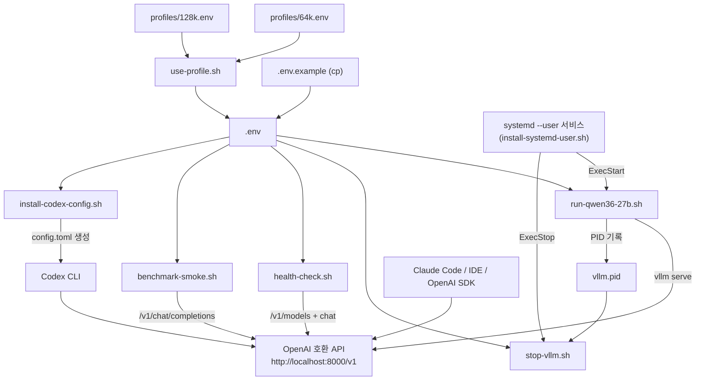

# vllm-setting

로컬 GPU에서 Qwen 계열 LLM을 OpenAI 호환 API로 서빙하고, Codex CLI·Claude Code 같은 코딩 에이전트를 연결하기 위한 셸 스크립트 + 환경 프로필 모음입니다.

## 개요

이 레포는 개인용(1인 코딩 에이전트/IDE/CLI) 로컬 LLM 서버를 재현 가능하게 띄우기 위해 존재합니다. 두 가지 하드웨어 타깃을 다룹니다.

| 구성 | 하드웨어 | 모델 | 백엔드 | API |
|---|---|---|---|---|
| 루트 디렉터리 (기본) | 2x RTX 4090 | `Qwen/Qwen3.6-27B-FP8` | vLLM | `http://localhost:8000/v1`, 모델명 `qwen3.6-27b` |
| `qwen3-coder-2080ti/` | 2x RTX 2080 Ti (11 GB x 2) | `Qwen3-Coder-30B-A3B-Instruct` | llama.cpp(권장) / vLLM(best-effort) | `http://127.0.0.1:8080/v1`(llama.cpp), 모델명 `qwen3-coder-30b-a3b` |

모든 튜닝 값은 `.env` 파일로 오버라이드할 수 있고, 스크립트 자체를 수정할 필요가 없도록 설계되어 있습니다.

## 코드 구성

```text
vllm-setting/
├── run-qwen36-27b.sh          # vLLM 실행 (2x 4090, Qwen3.6-27B-FP8)
├── stop-vllm.sh               # vLLM 프로세스 트리 종료 및 GPU 반환
├── health-check.sh            # /v1/models + chat completion 확인
├── benchmark-smoke.sh         # 코딩 프롬프트 3종 성능 스모크 테스트
├── use-profile.sh             # profiles/*.env를 .env로 활성화(백업 포함)
├── install-systemd-user.sh    # systemd --user 서비스 설치
├── install-codex-config.sh    # Codex CLI용 ~/.codex/config.toml 생성
├── .env.example               # 루트 구성 설정 예시
├── profiles/
│   ├── 64k.env                # 안정 기본 프로필 (MAX_MODEL_LEN=65536)
│   └── 128k.env               # 롱 컨텍스트 프로필 (MAX_MODEL_LEN=131072)
├── systemd/
│   └── vllm-qwen36.service.in # systemd user 서비스 템플릿
└── qwen3-coder-2080ti/        # 2x RTX 2080 Ti용 별도 구성
    ├── install-llama-cpp.sh   # llama.cpp CUDA 빌드 (SM 7.5)
    ├── download-gguf.sh       # GGUF 모델 다운로드 (기본 Q4_K_S)
    ├── run-llama-server.sh    # llama-server 실행 (권장 경로)
    ├── run-vllm-server.sh     # vLLM 실행 (대안 경로, AWQ 4-bit)
    ├── health-check.sh        # BACKEND=llama|vllm 헬스 체크
    ├── stop-server.sh         # PID 파일 기반 서버 종료
    └── .env.example           # 2080 Ti 구성 설정 예시
```

`.env`, `vllm.pid`, 모델 파일, llama.cpp 체크아웃 등은 `.gitignore`로 Git에서 제외됩니다.

## 설계

핵심 패턴은 "설정은 `.env`, 로직은 스크립트"입니다. 모든 스크립트는 시작 시 같은 디렉터리의 `.env`를 `set -a`로 로드하고, 각 변수에 `${VAR:-default}` 기본값을 두므로 `.env` 없이도 동작합니다. 프로필 전환은 파일 복사(`use-profile.sh`)로 처리하고, 서버 수명 관리는 PID 파일 + 포트/프로세스 탐색의 이중 안전장치로 처리합니다. systemd 서비스는 run/stop 스크립트를 그대로 감싸므로 수동 실행과 서비스 실행이 동일한 코드 경로를 탑니다.



`qwen3-coder-2080ti/`도 같은 패턴을 따르되, 백엔드가 llama.cpp(기본, 포트 8080)와 vLLM(대안, 포트 8000) 두 갈래이고 `health-check.sh`가 `BACKEND` 변수로 대상을 선택합니다.

## 스크립트 안내

### `run-qwen36-27b.sh` — vLLM 서버 실행

- `.env`가 있으면 로드한 뒤 `vllm serve`를 exec으로 실행합니다. 기본값: 모델 `Qwen/Qwen3.6-27B-FP8`, 서빙 이름 `qwen3.6-27b`, `PORT=8000`, `TP_SIZE=2`, `MAX_MODEL_LEN=65536`, `MAX_NUM_SEQS=1`.
- 1인 코딩용 플래그가 기본 적용됩니다: `--enable-prefix-caching`, `--enable-chunked-prefill`, `--disable-custom-all-reduce`, `--reasoning-parser qwen3`, `--language-model-only`(이미지 입력 미사용).
- `ENABLE_TOOL_CALLS=1`이면 `--enable-auto-tool-choice --tool-call-parser qwen3_coder`를 추가합니다.
- 시작 시 자신의 PID를 `vllm.pid`에 기록합니다.

### `stop-vllm.sh` — 안전한 종료

- `vllm.pid` → 포트 리스너(`ss`) → 프로세스 목록(`ps`) 순으로 vLLM 프로세스를 찾고, 자식 워커까지 재귀적으로 수집합니다.
- SIGTERM 후 `TIMEOUT_SECONDS`(기본 30초) 대기, 남으면 SIGKILL로 GPU 메모리를 확실히 반환합니다.

### `health-check.sh` — 헬스 체크

- `/v1/models`가 준비될 때까지(기본 최대 300초) 폴링한 뒤, 짧은 chat completion 요청까지 보내 실제 응답을 확인합니다.
- `CHAT_CHECK=0`이면 models 엔드포인트 확인만 수행합니다.

### `benchmark-smoke.sh` — 스모크 벤치마크

- 코딩 프롬프트 3종(binary-search, bug-review, lru-cache)을 순차 실행해 latency, completion token 수, 초당 토큰(tok/s)을 출력합니다.
- `nvidia-smi`가 있으면 실행 전후 GPU 메모리도 함께 표시합니다. `BENCH_MAX_TOKENS`로 생성 토큰 수 조절.

### `use-profile.sh` — 실행 프로필 전환

- `profiles/64k.env`(안정 기본값), `profiles/128k.env`(롱 컨텍스트)를 `.env`로 복사해 활성화합니다.
- 기존 `.env`는 타임스탬프 백업(`.env.backup.*`) 후 교체하고, 새 `.env`는 `chmod 600` 처리합니다.

### `install-systemd-user.sh` — systemd user 서비스 설치

- `systemd/vllm-qwen36.service.in` 템플릿의 `__WORKDIR__`을 현재 체크아웃 경로로 치환해 `~/.config/systemd/user/vllm-qwen36.service`로 설치하고 enable까지 수행합니다.
- 서비스는 `ExecStart`에 run 스크립트, `ExecStop`에 stop 스크립트를 사용하며 `Restart=on-failure`입니다.

### `install-codex-config.sh` — Codex CLI 설정 생성

- `.env`의 `SERVED_MODEL_NAME`/`PORT`를 읽어 `~/.codex/config.toml`을 생성하고, Codex CLI가 로컬 vLLM 서버를 기본 모델로 쓰게 합니다.
- 기존 config.toml은 타임스탬프 백업(`config.toml.backup.*`) 후 교체합니다.
- `.env`에 `ENABLE_TOOL_CALLS=1`이 아니면 경고를 출력합니다(Codex는 tool calling이 필수).
- `CODEX_MODEL`/`CODEX_BASE_URL`/`CODEX_HOME`으로 대상을 바꿀 수 있습니다 — 방법은 "코딩 에이전트 연동 > Codex CLI > 환경 변수로 설정 바꾸기" 참고.

## 실행 가이드

### 1. 설치 (vLLM이 없는 경우)

별도 Python 가상환경에서 설치합니다.

```bash
uv venv
source .venv/bin/activate
uv pip install -U vllm --torch-backend=auto
```

`uv`를 쓰지 않는 환경이면 `pip install -U vllm`로 설치해도 됩니다.

### 2. 최초 설정

```bash
cd /home/kms/dev/vllm-setting
cp .env.example .env
chmod +x *.sh
```

필요하면 `.env`에서 GPU 번호(`CUDA_VISIBLE_DEVICES`), 포트(`PORT`), 컨텍스트 길이(`MAX_MODEL_LEN`)를 수정합니다. 프로필을 바로 쓰려면:

```bash
./use-profile.sh 64k    # 안정 기본값 (65536)
./use-profile.sh 128k   # 롱 컨텍스트 (131072)
```

### 3. 시작 / 확인 / 종료

```bash
./run-qwen36-27b.sh     # 서버 시작 → http://localhost:8000/v1, 모델명 qwen3.6-27b
./health-check.sh       # /v1/models 대기 후 chat completion 확인 (CHAT_CHECK=0으로 생략 가능)
./benchmark-smoke.sh    # 스모크 벤치마크 (BENCH_MAX_TOKENS=1024 등으로 조절)
./stop-vllm.sh          # 종료 후 nvidia-smi로 GPU 메모리 반환 확인
```

OpenAI SDK 호환 클라이언트 연결 예시:

```python
from openai import OpenAI

client = OpenAI(base_url="http://localhost:8000/v1", api_key="EMPTY")
response = client.chat.completions.create(
    model="qwen3.6-27b",
    messages=[{"role": "user", "content": "Write a concise Python binary search function."}],
    temperature=0.6,
    top_p=0.95,
    max_tokens=2048,
)
print(response.choices[0].message.content)
```

### 4. systemd user 서비스 (선택)

터미널을 닫아도 서버를 유지하려면:

```bash
./install-systemd-user.sh
systemctl --user start vllm-qwen36.service

# 상태/로그
systemctl --user status vllm-qwen36.service
journalctl --user -u vllm-qwen36.service -f

# 재시작/종료
systemctl --user restart vllm-qwen36.service
systemctl --user stop vllm-qwen36.service
```

부팅 후 자동 시작에는 환경에 따라 linger가 필요할 수 있습니다: `loginctl enable-linger "$USER"`.

## 코딩 에이전트 연동

Codex CLI와 Claude Code 모두 공통 전제는 두 가지입니다: **서버가 떠 있어야 하고**, **`ENABLE_TOOL_CALLS=1`**이 켜져 있어야 합니다. 후자는 바로 아래 "사전 준비"대로 설정합니다.

### 사전 준비: `ENABLE_TOOL_CALLS=1` 켜기

**이게 뭔가:** `ENABLE_TOOL_CALLS`는 Codex나 Claude Code의 설정이 **아니라**, 이 레포가 정의한 **vLLM 서버 쪽 스위치**입니다. 클라이언트/서버 설정은 완전히 분리돼 있습니다:

| 쪽 | 설정 파일 | 무엇을 정하나 |
|---|---|---|
| Codex (클라이언트) | `~/.codex/config.toml` | 어느 서버에 접속할지, 어떤 모델명을 쓸지 |
| vLLM 서버 (이 레포) | 레포 루트 `.env` | 서버를 어떤 옵션으로 띄울지 — `ENABLE_TOOL_CALLS`는 여기 |

**왜 필요한가:** `run-qwen36-27b.sh`가 서버를 시작할 때 `.env`를 읽고, `ENABLE_TOOL_CALLS=1`이면 `vllm serve`에 `--enable-auto-tool-choice --tool-call-parser qwen3_coder` 옵션을 붙입니다. 이 옵션이 있어야 vLLM이 tool calling — 모델이 "파일을 읽어라, 명령을 실행해라"를 일반 텍스트가 아닌 구조화된 함수 호출로 응답하는 기능 — 을 OpenAI 형식으로 처리할 수 있습니다. 코딩 에이전트는 파일 편집·명령 실행을 전부 tool calling으로 수행하므로, 이게 꺼져 있으면(기본값 `0`) 채팅은 되지만 실제 작업은 하나도 못 합니다.

**어디서 바꾸나:** 레포 루트의 `.env` 파일입니다 (`/home/kms/dev/vllm-setting/.env` — 최초 설정 때 `cp .env.example .env`로 만든 파일). Codex 쪽에서는 아무것도 바꾸지 않습니다.

**어떻게:**

```bash
cd /home/kms/dev/vllm-setting

# 1) .env 열어서 ENABLE_TOOL_CALLS=0 줄을 1로 수정 (에디터 사용 시)
nano .env

#    또는 한 줄로 바로 수정:
sed -i 's/^ENABLE_TOOL_CALLS=0/ENABLE_TOOL_CALLS=1/' .env

# 2) 반영됐는지 확인 (ENABLE_TOOL_CALLS=1 이 출력돼야 함)
grep ENABLE_TOOL_CALLS .env

# 3) 서버 재시작 — .env는 서버 시작 시점에만 읽히므로 재시작 필수
./stop-vllm.sh && ./run-qwen36-27b.sh
#    systemd 사용 시: systemctl --user restart vllm-qwen36.service
```

> ⚠️ **프로필 전환 시 리셋됩니다.** `./use-profile.sh 64k`/`128k`는 `.env`를 프로필 파일로 통째로 교체하는데, `profiles/64k.env`와 `profiles/128k.env` 모두 `ENABLE_TOOL_CALLS=0`입니다. 프로필을 바꾼 뒤에는 위 1~3단계를 다시 실행하세요. (에이전트를 계속 쓸 거라면 `profiles/*.env` 안의 값을 아예 `1`로 바꿔두는 것도 방법입니다.)

이 값이 켜지면 `run-qwen36-27b.sh`가 vLLM에 `--enable-auto-tool-choice --tool-call-parser qwen3_coder` 플래그를 추가해 OpenAI 형식의 tool calling을 처리합니다.

### Codex CLI

기본 사용 흐름 — vLLM으로 qwen3.6-27b를 띄운 뒤 Codex를 붙입니다:

```bash
./run-qwen36-27b.sh         # 1) 서버 시작 (또는 systemctl --user start vllm-qwen36)
./install-codex-config.sh   # 2) 최초 1회: ~/.codex/config.toml 생성 (기존 파일은 타임스탬프 백업)
codex                       # 3) qwen3.6-27b가 기본 모델로 바로 실행됨
```

생성된 config가 `model = "qwen3.6-27b"` + `model_provider = "vllm"`을 기본값으로 잡으므로 실행 즉시 로컬 모델을 사용합니다. 세션 중 모델 확인·전환은 `/model` 명령으로 합니다(같은 프로바이더 안에서 서빙 이름 기준).

#### 환경 변수로 설정 바꾸기

`install-codex-config.sh`는 **실행하는 시점에** 아래 변수를 읽어 config.toml을 만듭니다. 즉, 변수를 바꾼 뒤에는 **스크립트를 다시 실행해야** 반영됩니다.

| 변수 | 기본값 | 의미 |
|---|---|---|
| `CODEX_MODEL` | `.env`의 `SERVED_MODEL_NAME` (기본 `qwen3.6-27b`) | config에 기록할 모델명. 서버의 서빙 이름과 일치해야 함 |
| `CODEX_BASE_URL` | `http://127.0.0.1:$PORT/v1` (기본 포트 8000) | Codex가 접속할 서버 주소 |
| `CODEX_HOME` | `~/.codex` | config.toml을 쓸 디렉터리 |

바꾸는 방법은 두 가지입니다.

**방법 A — `.env`에 영구 저장 (반복 사용 시 권장).** 레포 루트의 `.env` 파일에 값을 추가하면 스크립트가 실행할 때마다 자동으로 읽습니다. `.env.example` 하단에 주석 처리된 예시가 있으니 주석을 풀어 쓰면 됩니다.

```bash
# .env 파일에 추가 (편집: nano .env 또는 vi .env)
CODEX_MODEL=qwen3.6-27b
CODEX_BASE_URL=http://127.0.0.1:8000/v1
```

```bash
./install-codex-config.sh   # 수정 후 재실행해야 config.toml에 반영됨
```

**방법 B — 명령 앞에 1회성으로 지정 (임시 전환 시).** 터미널에서 명령 앞에 `변수=값`을 붙이면 그 실행에만 적용되고 `.env`는 건드리지 않습니다.

```bash
# 예: 2080 Ti 구성의 llama.cpp 서버(포트 8080)로 임시 전환
CODEX_MODEL=qwen3-coder-30b-a3b CODEX_BASE_URL=http://127.0.0.1:8080/v1 ./install-codex-config.sh
```

생성 결과는 `~/.codex/config.toml`을 열어 직접 확인·수정할 수도 있습니다(단, 스크립트를 다시 돌리면 타임스탬프 백업 후 덮어씁니다):

```toml
model = "qwen3.6-27b"
model_provider = "vllm"

[model_providers.vllm]
name = "vLLM local (qwen3.6-27b)"
base_url = "http://127.0.0.1:8000/v1"
wire_api = "chat"
```

### Claude Code

Claude Code는 Anthropic Messages API(`/v1/messages`) 형식으로 통신하므로, OpenAI 호환 엔드포인트인 이 서버에 바로 붙일 수 없고 LiteLLM 프록시를 변환 계층으로 둡니다.

**1) LiteLLM 설치 및 실행:**

```bash
pip install 'litellm[proxy]'
```

```yaml
# litellm_config.yaml
model_list:
  - model_name: qwen3.6-27b
    litellm_params:
      model: hosted_vllm/qwen3.6-27b
      api_base: http://localhost:8000/v1
```

```bash
litellm --config litellm_config.yaml --port 4000
```

**2) Claude Code가 프록시를 보도록 환경 변수 설정.** 두 방법 중 하나를 씁니다.

방법 A — `~/.claude/settings.json`의 `"env"` 블록에 저장 (권장, Claude Code 실행 시 항상 적용):

```json
{
  "env": {
    "ANTHROPIC_BASE_URL": "http://localhost:4000",
    "ANTHROPIC_AUTH_TOKEN": "dummy",
    "ANTHROPIC_MODEL": "qwen3.6-27b",
    "ANTHROPIC_SMALL_FAST_MODEL": "qwen3.6-27b"
  }
}
```

방법 B — 터미널에서 export 후 실행 (그 터미널 세션에만 적용):

```bash
export ANTHROPIC_BASE_URL="http://localhost:4000"
export ANTHROPIC_AUTH_TOKEN="dummy"
export ANTHROPIC_MODEL="qwen3.6-27b"
export ANTHROPIC_SMALL_FAST_MODEL="qwen3.6-27b"
claude
```

**참고 — 프록시 없이 직결:** 최근 vLLM은 Anthropic 호환 `/v1/messages` 엔드포인트를 자체 지원하기 시작했습니다. 서버 실행 후 `curl -s localhost:8000/v1/messages`가 404가 아니면, LiteLLM 없이 `ANTHROPIC_BASE_URL=http://localhost:8000`으로 직결할 수 있습니다.

### 공통 주의사항

- **`ENABLE_TOOL_CALLS=1` 필수.** 설정 위치와 절차는 위 "사전 준비" 참고. 프로필 전환 후 리셋되는 점에 특히 주의.
- **`MAX_NUM_SEQS=2~4` 권장.** Claude Code는 본 요청 외에 백그라운드 요청(세션 제목 생성, 서브에이전트 등)을 병렬로 보냅니다. 기본값 `1`이면 이 요청들이 직렬 대기하므로 에이전트 용도에서는 2~4가 낫습니다. prefix caching이 켜져 있어 KV cache 부담은 크지 않습니다.
- **컨텍스트는 넉넉하게.** 에이전트의 시스템 프롬프트 + 도구 정의만으로 수만 토큰을 차지하므로 64K 이상(가능하면 `./use-profile.sh 128k`)을 권장합니다.
- 웹 검색 같은 Anthropic 서버사이드 기능은 커스텀 백엔드에서 동작하지 않습니다.

## 2080 Ti 구성 (`qwen3-coder-2080ti/`)

2x RTX 2080 Ti(11 GB x 2)에서 `Qwen3-Coder-30B-A3B-Instruct`를 서빙하는 별도 구성입니다. 구성 요소:

- `install-llama-cpp.sh`: llama.cpp를 clone하고 CUDA(SM 7.5)로 `llama-server`/`llama-cli`를 빌드합니다.
- `download-gguf.sh`: `unsloth/Qwen3-Coder-30B-A3B-Instruct-GGUF`에서 GGUF(기본 `Q4_K_S`, 약 17.5 GB)를 이어받기 지원으로 다운로드합니다.
- `run-llama-server.sh`: 기본 `http://127.0.0.1:8080/v1`, 컨텍스트 16K, KV cache `q8_0`, layer split으로 llama-server를 실행합니다.
- `run-vllm-server.sh`: 4-bit AWQ 체크포인트(`cyankiwi/Qwen3-Coder-30B-A3B-Instruct-AWQ-4bit`), 8K 컨텍스트, TP=2 + expert parallel의 best-effort vLLM 대안 경로입니다.
- `health-check.sh`(`BACKEND=llama|vllm` 선택), `stop-server.sh`(두 백엔드의 PID 파일 기반 종료)를 제공합니다.

### 권장 경로 (llama.cpp)

Git, CMake, CUDA Toolkit(`nvcc`), C/C++ 빌드 도구, curl 필요:

```bash
cd qwen3-coder-2080ti
cp .env.example .env
chmod +x *.sh
./install-llama-cpp.sh
./download-gguf.sh
./run-llama-server.sh            # http://127.0.0.1:8080/v1, 모델명 qwen3-coder-30b-a3b (포그라운드)
BACKEND=llama ./health-check.sh  # 다른 터미널에서
./stop-server.sh
```

품질을 우선하고 16K 이하 컨텍스트를 쓸 경우:

```bash
GGUF_QUANT=Q4_K_M ./download-gguf.sh
MODEL_PATH="$PWD/models/Qwen3-Coder-30B-A3B-Instruct-Q4_K_M.gguf" \
  LLAMA_CTX_SIZE=16384 ./run-llama-server.sh
```

### 대안 경로 (vLLM, best-effort)

```bash
cd qwen3-coder-2080ti
python3 -m venv .venv-vllm
source .venv-vllm/bin/activate
pip install -U pip vllm
./run-vllm-server.sh
BACKEND=vllm ./health-check.sh
```

### OOM 대처

- llama.cpp: `LLAMA_CTX_SIZE=8192` → `LLAMA_TENSOR_SPLIT=0.45,0.55`(GPU 0이 화면 출력을 담당할 때) → KV cache `q4_0` 순으로 낮춥니다.
- vLLM: `VLLM_MAX_MODEL_LEN=4096`으로 낮춥니다.

이 서버에 Codex를 붙이려면 "코딩 에이전트 연동 > Codex CLI > 환경 변수로 설정 바꾸기"의 방법 B를 참고하세요.

## 컨텍스트 튜닝 노트

- 기본 `MAX_MODEL_LEN=65536`은 2x24GB에서 안정성을 우선한 값입니다. 1인 사용이므로 `MAX_NUM_SEQS=1`로 KV cache를 한 세션에 몰아줍니다. 단, Claude Code처럼 백그라운드 요청을 병렬로 보내는 에이전트를 붙일 때는 `MAX_NUM_SEQS=2~4`가 낫습니다("코딩 에이전트 연동 > 공통 주의사항" 참고).
- Qwen3.6-27B는 하이브리드 어텐션(레이어 4개 중 1개만 full attention)이라 KV cache가 토큰당 약 64KB로 작아, 128K도 bf16 KV(`KV_CACHE_DTYPE=auto`) 그대로 여유 있게 들어갑니다. `fp8` KV는 이 모델에서는 메모리상 불필요하고 품질을 약간 깎을 수 있어 쓰지 않습니다.
- OOM이 나면 `MAX_MODEL_LEN`을 `98304` 또는 `65536`으로 낮추는 쪽이 가장 효과적입니다.
- `--enable-prefix-caching`: 같은 repo/context를 반복 투입하는 코딩 에이전트 워크로드에 유리합니다.
- `--disable-custom-all-reduce`: NVLink 없는 4090 2장 환경에서 안정성을 우선합니다.
- `ENABLE_TOOL_CALLS=1`: OpenAI tool calling을 vLLM parser(`qwen3_coder`)로 처리하고 싶을 때만 켭니다. 코딩 에이전트(Codex/Claude Code)를 붙일 때는 필수입니다.
- 2080 Ti는 Turing(SM 7.5)이므로 FP8 모델을 사용하지 않습니다. 외부 접근이 필요할 때만 `HOST=0.0.0.0`으로 바꾸고 방화벽/리버스 프록시 인증을 함께 설정합니다.
