# 설계 구조

이 문서는 레포 전체를 하나의 시스템으로 보고 **왜 이렇게 나뉘어 있는지**를 설명한다. 개별 타깃의 설정값은 [targets.md](targets.md), 변수 의미는 [config.md](config.md), 스크립트 사용법 요약은 [scripts.md](scripts.md)에 있고, 이 문서는 그 위 층위 — 경계, 책임 분할, 불변식(invariant), 설계 결정의 대가 — 를 다룬다. 짧은 설계 요약본은 [design.md](design.md)이며, 이 문서는 그것을 대체하지 않고 확장한다.

## 1. 목적과 범위

### 1.1 이 레포가 하는 일

로컬 GPU에서 Qwen 계열 모델을 **OpenAI 호환 HTTP API**로 띄우고, 그 서버를 코딩 에이전트(Codex CLI, OpenCode, Claude Code)에 연결하기 위한 셸 스크립트와 환경 파일 모음이다. 감지한 하드웨어에 맞는 추적 타깃과 설정을 추천하고, 산출물로 **재현 가능한 기동 절차**를 제공한다.

### 1.2 이 레포가 하지 않는 일

실측한 범위는 다음과 같다.

- **파이썬 코드가 없다.** 추적 파일에 `.py`는 0개다. 유일한 파이썬 사용처는 `install-opencode-config.sh` 안에 heredoc으로 들어간 JSON 병합 스니펫이다.
- **모델 품질 평가 하네스는 없다.** 과거 scorer + mock-server E2E는 `8cc0096`에서 제거됐다. 대신 하드웨어 advisor에는 순수 시뮬레이션 회귀 테스트가 있고, 실제 모델 응답·성능은 `health-check.sh`와 `benchmark-smoke.sh`로 검증한다.
- **모델 학습·양자화·다운로드 자동화가 (거의) 없다.** vLLM 타깃은 HuggingFace 캐시의 자동 다운로드에 의존하고, 명시적 다운로드 스크립트는 GGUF용 `qwen3-coder-2080ti/download-gguf.sh` 하나뿐이다.
- **인증·TLS·리버스 프록시 구성이 없다.** `HOST` 기본값이 `0.0.0.0`이므로 노출 시 보호는 전적으로 외부 방화벽 책임이다.

### 1.3 규모 (실측)

`git ls-files` 및 `wc -l` 기준.

| 분류 | 파일 수 | 줄 수 |
|---|---:|---:|
| 셸 스크립트 (`*.sh`) | 18 | 2,544 |
| ├ 루트 스크립트 | 8 | 1,291 |
| ├ `targets/` 실행 스크립트 | 3 | 685 |
| ├ `qwen3-coder-2080ti/` | 6 | 444 |
| └ `tests/` | 1 | 124 |
| Markdown 문서 (`*.md`) | 11 | 2,857 |
| 설정 템플릿 (`*.env`, `*.env.example`) | 6 | 203 |
| systemd 유닛 템플릿 | 1 | 18 |
| `.gitignore` | 1 | 14 |
| **추적 파일 합계** | **37** | **5,636** |

여기에 비추적 로컬 파일 `.env`(40줄)가 더해진다. 셸의 약 4분의 1은 하드웨어 감지·판정·JSON 출력을 한 파일에서 담당하는 `recommend-settings.sh`이고, 실행 타깃 3종은 독립 사전 점검을 유지한다.

## 2. 구성 요소와 책임

레포는 7개 층으로 나뉜다. 각 층은 아래 층에 대해서만 알고, 위 층을 참조하지 않는다.

### 2.1 설정층 — `.env`, `profiles/`, `targets/*.env`

값만 담고 로직은 없는 평문 `KEY=VALUE` 파일. Git에는 `*.example`과 `profiles/*.env`만 올라가고, 실제로 읽히는 `.env`·`targets/*.env`·`qwen3-coder-2080ti/.env`는 `.gitignore`로 제외된다. **머신마다 다른 값**이라는 전제가 이 분리의 이유다.

세 갈래로 나뉜다.

| 파일 | 읽는 주체 | Git 추적 |
|---|---|---|
| `.env` (루트) | `targets/qwen36-27b-4090x2.sh` + 루트 보조 스크립트 6개 | 제외 (`.env.example`만 추적) |
| `targets/qwen38-27b-{h100x2,4090x2}.env` | 해당 타깃 스크립트 **하나씩만** | 제외 (`.env.example`만 추적) |
| `qwen3-coder-2080ti/.env` | 그 디렉터리 스크립트 4개 | 제외 (`.env.example`만 추적) |

`profiles/64k.env`·`profiles/128k.env`는 읽히는 파일이 아니라 **`.env`로 복사될 후보**다. `use-profile.sh`가 복사기 역할을 한다.

### 2.2 실행층 — `targets/*.sh`

하드웨어 구성 하나가 스크립트 하나에 대응한다. 각 스크립트는 (a) 자기 설정 파일 로드, (b) 사전 점검, (c) `vllm serve` 인자 배열 조립, (d) 요약 출력, (e) PID 기록 후 `exec` 순서를 그대로 따른다. 세 스크립트는 서로를 호출하지 않고 공통 라이브러리도 공유하지 않는다 — 사전 점검 코드가 세 파일에 복제돼 있다.

### 2.3 운영층 — `stop-vllm.sh`, `health-check.sh`, `benchmark-smoke.sh`, `use-profile.sh`

타깃과 무관하게 루트에서 실행되는 공통 도구. 종료·준비 확인·성능 확인·프로필 전환이 각각 한 파일이다. 이들은 **모두 루트 `.env`만** 읽는다 (§4.2의 대가).

### 2.4 통합층 — `install-codex-config.sh`, `install-opencode-config.sh`

서버가 아니라 **클라이언트 쪽 설정 파일**을 쓰는 스크립트. 레포 밖(`~/.codex/`, `~/.config/opencode/`)에 부작용을 남기는 유일한 층이다. 두 스크립트의 공통 계약은 "**기존 기본 모델을 바꾸지 않는다**"이며, 그래서 Codex는 별도 프로필 파일을, OpenCode는 프로바이더 키 하나만 갱신한다.

### 2.5 서비스층 — `systemd/`, `install-systemd-user.sh`

`systemd --user` 유닛 하나(`vllm-qwen36.service`)만 제공한다. 유닛은 로직을 갖지 않고 `ExecStart`/`ExecStop`으로 실행층·운영층 스크립트를 그대로 감싼다. **Qwen3.8 타깃용 유닛 템플릿은 없다** — 필요하면 직접 만들어야 한다.

### 2.6 격리 구성 — `qwen3-coder-2080ti/`

같은 패턴을 따르되 루트와 파일을 하나도 공유하지 않는 독립 하위 트리다. 2080 Ti는 Turing(SM 7.5)이라 FP8 커널을 쓸 수 없어 백엔드 자체가 llama.cpp로 갈라진다. 자체 `.env`·`health-check.sh`·`stop-server.sh`를 별도로 들고 있고, `BACKEND` 변수로 llama.cpp(8080)와 vLLM(8000) 중 점검 대상을 고른다.

### 2.7 판정층 — `recommend-settings.sh`, `tests/`

GPU별 전체/여유 VRAM과 compute capability, RAM, CPU, `/dev/shm`, 디스크를 읽어
추적 타깃 4종을 판정한다. 실행층의 runner와 기본값을 catalog로 기술하지만 runner를
호출하거나 `.env`를 쓰지는 않는다. 시뮬레이션 오버라이드와 JSON이 자동화 경계이고,
`tests/recommend-settings-test.sh`가 추천·JSON·catalog drift를 검증한다.

## 3. 설정 · 실행 · 검증의 흐름

```mermaid
flowchart TD
    subgraph CFG["설정층"]
        EX[".env.example"]
        P64["profiles/64k.env"]
        P128["profiles/128k.env"]
        ENV[".env<br/>(루트 공유)"]
        E38H["targets/qwen38-27b-h100x2.env"]
        E38C["targets/qwen38-27b-4090x2.env"]
        E20["qwen3-coder-2080ti/.env"]
    end

    subgraph RUN["실행층"]
        R36["targets/qwen36-27b-4090x2.sh"]
        R38H["targets/qwen38-27b-h100x2.sh"]
        R38C["targets/qwen38-27b-4090x2.sh"]
        RLL["qwen3-coder-2080ti/run-llama-server.sh"]
        RVL["qwen3-coder-2080ti/run-vllm-server.sh"]
    end

    subgraph OPS["운영층"]
        ADV["recommend-settings.sh"]
        STOP["stop-vllm.sh"]
        HC["health-check.sh"]
        BM["benchmark-smoke.sh"]
        UP["use-profile.sh"]
        S20["qwen3-coder-2080ti/stop-server.sh"]
        H20["qwen3-coder-2080ti/health-check.sh"]
    end

    HW["GPU/VRAM/RAM/CPU"] --> ADV
    ADV -.->|"fit + plan"| R36
    ADV -.->|"fit + plan"| R38H
    ADV -.->|"fit + plan"| R38C
    ADV -.->|"fit + plan"| RLL

    EX -->|cp| ENV
    P64 --> UP
    P128 --> UP
    UP -->|덮어쓰기 + chmod 600| ENV

    ENV --> R36
    E38H --> R38H
    E38C --> R38C
    E20 --> RLL
    E20 --> RVL

    ENV --> STOP
    ENV --> HC
    ENV --> BM
    ENV --> CX["install-codex-config.sh"]
    ENV --> OC["install-opencode-config.sh"]

    R36 -->|"exec vllm serve"| API8000["OpenAI 호환 API<br/>:8000/v1"]
    R38H -->|"exec vllm serve"| API8000
    R38C -->|"exec vllm serve"| API8000
    RVL -->|"exec vllm serve"| API8000
    RLL -->|"exec llama-server"| API8080["OpenAI 호환 API<br/>:8080/v1"]

    R36 -->|"echo \$\$"| PID1["vllm.pid"]
    R38H -->|"echo \$\$"| PID2["vllm-qwen38-h100x2.pid"]
    R38C -->|"echo \$\$"| PID3["vllm-qwen38-4090x2.pid"]
    RLL -->|"echo \$\$"| PID4["llama-server.pid"]
    RVL -->|"echo \$\$"| PID5["vllm-server.pid"]

    PID1 --> STOP
    PID2 -.->|"PID_FILE= 로 지정"| STOP
    PID3 -.->|"PID_FILE= 로 지정"| STOP
    PID4 --> S20
    PID5 --> S20

    HC --> API8000
    BM --> API8000
    H20 --> API8000
    H20 --> API8080

    CX --> CODEXF["~/.codex/qwen-local.config.toml"]
    OC --> OCF["~/.config/opencode/opencode.json"]
    CODEXF --> API8000
    OCF --> API8000

    SYSD["systemd --user<br/>vllm-qwen36.service"] -->|ExecStart| R36
    SYSD -->|ExecStop| STOP
```



흐름을 문장으로 옮기면 이렇다.

1. **판정** — advisor가 하드웨어를 감지해 기존 타깃의 fit/readiness와 설정을 제안한다.
2. **설정** — `.env.example`을 `.env`로 복사하거나 `use-profile.sh`로 프로필을 활성화한다. Qwen3.8 타깃은 `targets/*.env.example`을 자기 이름의 `.env`로 복사한다.
3. **실행** — 타깃 스크립트가 설정 파일을 로드하고 사전 점검을 통과하면 PID를 파일에 적고 `exec`으로 서버가 된다.
4. **검증** — `health-check.sh`가 실제 응답을 확인하고 `benchmark-smoke.sh`가 지연·tok/s를 잰다.
5. **연결** — installer 2종이 클라이언트 설정 파일을 쓴다.
6. **종료** — `stop-vllm.sh`가 프로세스 트리를 찾아 정상 종료 후 필요하면 강제 종료한다.

## 4. 설계 결정과 이유

### D1. 설정은 파일, 로직은 스크립트

모든 스크립트가 `set -a; source <env파일>; set +a` 뒤에 `VAR="${VAR:-기본값}"`을 두는 동일한 프렐류드를 쓴다. 덕분에 설정 파일이 아예 없어도 내장 기본값으로 동작하며, 설정 파일은 "차이나는 값만" 담으면 된다.

**우선순위는 명령줄 > 설정 파일 > 내장 기본값이다.** `source`가 실행하는 평문 대입은
환경에서 상속받은 값을 덮어쓰므로, 각 로더가 `source` 직전에 `env -0`으로 환경을 찍어 두고
직후에 되돌린다. 검증:

```
$ PORT=9999 ./health-check.sh
Checking vLLM at http://127.0.0.1:9999/v1        # 명령줄 값이 이긴다

$ ./health-check.sh
Checking vLLM at http://127.0.0.1:8000/v1        # 안 주면 .env 값
```

**2026-08-25 이전에는 반대였다** — 복원 단계가 없어 실제 우선순위가 **설정 파일 > 명령줄**이었고
`PORT=9999 ./health-check.sh`가 `.env`의 8000을 그대로 썼다. 문서 세 곳이 권하던
"값을 명령줄로 넘겨라"가 통하지 않았고, 이것이 D5의 대가를 실제 고장으로 만들었다.
`43d6a49`에서 수정(로더 12개 전부, 변수 전수 확인).

### D2. 하드웨어 구성 하나 = 스크립트 하나

조건 분기로 여러 하드웨어를 한 스크립트에 담지 않는다. 각 타깃은 자기 하드웨어에 맞는 기본값과 사전 점검을 독립적으로 들고 있다.

**얻는 것** — 한 타깃을 고쳐도 다른 타깃이 깨지지 않고, 사용자는 자기 구성 파일 하나만 읽으면 된다.
**대가** — 사전 점검 로직이 3벌 복제돼 있고 그 사이에 비대칭이 생겼다. 실측: `qwen36-27b-4090x2.sh`에는 **compute capability 점검이 없다.** 서빙하는 `Qwen/Qwen3.6-27B-FP8`도 FP8 체크포인트인데, sm89 요구 검사는 `qwen38-27b-4090x2.sh`에만 들어 있다.

### D3. 실행 전에 실패한다 (fail-fast preflight)

vLLM은 가중치를 다 읽은 뒤에야 OOM이나 아키텍처 미지원으로 죽는 경우가 많다. 수 분을 버리는 대신, 스크립트가 먼저 확인 가능한 것을 다 확인하고 원인·해결책을 적어 중단한다. 검증(이 머신에는 vLLM 미설치):

```
$ ./targets/qwen38-27b-h100x2.sh
ERROR: 'vllm' executable not found.
  Searched: PATH, ./.venv/bin/vllm
  ...
exit=1
```

**차단(exit 1)과 경고(계속 진행)의 경계**가 명시적으로 나뉘어 있다. 차단은 "이 머신에서는 절대 안 되는 것"(실행파일 없음, GPU 부족, VRAM 부족, 포트 점유, FP8 미지원 하드웨어), 경고는 "실패할 수도 있는 것"(`/dev/shm` 1 GiB 미만, 디스크 여유 부족, vLLM 버전 낮음)이다. vLLM 버전을 경고로만 둔 이유는 nightly 버전 문자열이 `sort -V` 비교를 통과하지 못하는 경우가 있어서다.

### D4. 종료는 이중 안전장치

PID 파일 하나만 믿으면 파일이 날아갔을 때 GPU 메모리가 물린 채 남는다. 그래서 `stop-vllm.sh`는 세 경로로 대상을 찾고(PID 파일 → `ss`의 포트 리스너 → `ps` 전체 스캔), 찾은 각 PID에 대해 `pgrep -P`로 자식을 재귀 수집한 뒤 트리째 종료한다. SIGTERM 후 `TIMEOUT_SECONDS`(기본 30초)를 기다리고 남으면 SIGKILL한다.

**대가** — 세 번째 경로가 넓다. 조건은 "cmdline에 `vllm`과 `serve`가 모두 있고, `$PORT`·`$MODEL`·`$SERVED_MODEL_NAME` 중 하나가 포함"이다. 세 vLLM 타깃이 모두 포트 8000을 쓰므로, **Qwen3.6을 멈추려고 실행한 명령이 같은 포트의 Qwen3.8 서버를 잡을 수 있다.** (`PID_FILE=... ./stop-vllm.sh`로 대상을 좁히는 것은 `43d6a49` 이후 정상 동작한다 — 그 전에도 `PID_FILE`이 `.env.example`에 없어 우연히 클로버되지 않았을 뿐이다.)

### D5. 설정 파일을 두 갈래로 나눈 이유

루트 `.env`는 `MODEL=Qwen/Qwen3.6-27B-FP8`을 고정한다. Qwen3.8 타깃이 이 파일을 같이 읽으면
모델이 조용히 Qwen3.6으로 바뀐다. 그래서 Qwen3.8 타깃 두 개는 루트 `.env`를 **읽지 않고**
`targets/<타깃>.env`만 읽는다.

**대가** — 운영층 스크립트는 여전히 루트 `.env`만 읽는다. 기존 문서와 `targets/*.env.example`
주석은 이 간극을 "값을 명령줄로 넘겨라"로 해결하라고 안내하는데, `43d6a49` 이후 **그 안내가
실제로 통한다**(`SERVED_MODEL_NAME=qwen3.8-27b ./benchmark-smoke.sh` → `Model: qwen3.8-27b`).
그 전에는 D1 때문에 통하지 않았다.

```
$ SERVED_MODEL_NAME=qwen3.8-27b ./benchmark-smoke.sh
Benchmark endpoint: http://127.0.0.1:8000/v1
Model: qwen3.6-27b-fp8          # 넘긴 값이 .env에 덮어써짐
```

Qwen3.8 서버에 `qwen3.6-27b-fp8`이라는 모델명으로 요청이 가면 서버는 그 모델을 모른다. 대처법은 [USAGE.md](USAGE.md) §5.2에 정리했다.

### D6. 경로는 루트에 모은다

타깃 스크립트는 `SCRIPT_DIR`(= `targets/`)과 `REPO_ROOT`(= 레포 루트)를 구분해 잡는다. 타깃 전용 설정 파일만 `SCRIPT_DIR`에서 찾고, **PID 파일과 `.venv`는 `REPO_ROOT`**에 둔다. 어느 타깃을 띄웠든 루트에서 `./stop-vllm.sh`, `./health-check.sh`를 그대로 쓸 수 있게 하기 위한 배치다.

### D7. installer는 기본 모델을 건드리지 않는다

로컬 모델은 "선택 옵션"이지 "대체"가 아니라는 전제다. Codex는 `~/.codex/config.toml`을 아예 수정하지 않고 `~/.codex/<프로필>.config.toml` 오버레이 파일만 쓴다. OpenCode는 JSON을 파싱해 `provider.<키>` 항목 하나만 갱신하고 나머지 키를 보존한다. 두 경우 모두 타임스탬프 백업을 남긴다.

Codex 쪽에는 **마이그레이션 책임**이 하나 더 붙어 있다. 최신 Codex가 `config.toml` 안의 `[profiles.*]`를 거부하므로, 구버전 스크립트가 심어둔 관리 블록·`[model_providers.vllm]` 섹션·강제된 최상위 기본 모델을 awk 3단계로 걷어낸다(자세한 로직은 [CODE.md](CODE.md) §5.1).

### D8. 포그라운드 `exec` + 자기 PID 기록

모든 run 스크립트는 마지막에 `echo "$$" > "$PID_FILE"` 후 `exec`한다. `exec`은 프로세스를 교체하므로 PID 파일의 값이 그대로 서버 프로세스의 PID가 된다. 데몬화·`nohup`·`&`를 쓰지 않는다.

**얻는 것** — systemd `Type=simple`이 MAINPID를 정확히 잡고, 수동 실행과 서비스 실행이 완전히 같은 코드 경로를 탄다. 로그는 터미널 또는 journal로 그대로 흐른다.
**대가** — 터미널을 닫으면 서버가 죽는다. 지속 실행에는 systemd나 tmux가 필요하다. 또한 `exec` 직후 vLLM이 즉시 죽어도 PID 파일은 남는다(stale PID 파일은 `stop-vllm.sh`가 `kill -0` + cmdline 검사로 걸러낸다).

### D9. 추천은 읽기 전용이고 실행보다 앞선다

advisor는 용량 기반 사전 의사결정만 맡는다. `fit`은 설치된 하드웨어 용량,
`ready`는 현재 여유 VRAM을 나타내며, 추천 결과가 runner의 사전 점검을 우회하지
않는다. 범용 모델 탐색은 llmfit에 남기고 이 레포에서는 실제 runner가 있는 타깃만
지원 대상으로 부른다. 비교 근거는 [llmfit-comparison.md](llmfit-comparison.md)에 있다.

## 5. 불변식

코드 전반이 유지하는 규칙. 새 타깃·새 스크립트를 추가할 때 지켜야 한다.

1. **모든 셸 스크립트는 `set -euo pipefail`로 시작한다.** 18개 스크립트 전부 해당.
2. **모든 셸 스크립트는 자기 위치를 `BASH_SOURCE` 기준으로 잡는다.** 따라서 어느 디렉터리에서 호출하든 동작한다.
3. **모든 run 스크립트는 PID 파일에 자기 `$$`를 적고 `exec`한다.**
4. **설정 파일은 값만 담고 명령을 실행하지 않는다.** (`source`되므로 명령을 넣으면 실행되지만, 현재 6개 템플릿 어디에도 명령이 없다.)
5. **에러는 stderr, 원인 한 줄 + 해결책 한 줄, exit 1.** 사전 점검 블록 전체가 이 형식을 지킨다.
6. **레포 밖 파일을 고치는 스크립트는 백업을 남긴다.** installer 2종 + `use-profile.sh`.
7. **vLLM 타깃은 포트 8000, llama.cpp는 8080.**

## 6. 기존 문서 지도

문서가 각각 어느 국면을 담당하는지 정리한다.

| 문서 | 담당 국면 | 층위 | 이 문서들과의 관계 |
|---|---|---|---|
| [README.md](../README.md) | 레포 첫 진입, advisor, 타깃 목록, 빠른 시작 | 개요 | 세부 문서로 연결 |
| [targets.md](targets.md) | **설정 시점** — 하드웨어별로 어떤 값을 쓸지, 왜 그 값인지, OOM 대처 | 타깃별 | ARCHITECTURE는 타깃 간 *비대칭*을, CODE는 인자 조립 규칙을 다룸 |
| [config.md](config.md) | **설정 시점** — 변수 하나하나의 의미와 조정 가이드 | 변수별 | CODE §7이 "어느 스크립트가 읽는지 / `.env.example`에 있는지 / 명령줄 오버라이드가 통하는지"를 추가 |
| [scripts.md](scripts.md) | **운영 시점** — 보조 스크립트가 무엇을 하는지 1~3줄 요약 | 요약 | CODE §4~§6이 같은 스크립트의 내부 알고리즘과 상수를 다룸 |
| [agents.md](agents.md) | **연결 시점** — Codex/OpenCode/Claude Code 붙이는 절차, LiteLLM 프록시 | 클라이언트 | USAGE §6이 요약 + 링크만, 절차 원본은 agents.md |
| [design.md](design.md) | 설계 요약 (69줄) — 원칙 4개, 두 갈래 이유, 흐름도, 경로 규칙 | 설계 요약 | **이 문서가 확장판.** design.md는 "무엇을 했나", ARCHITECTURE는 "왜·어떤 대가로·어떤 비대칭이 남았나" |
| [ARCHITECTURE.md](ARCHITECTURE.md) | 목적·범위·층 구조·설계 결정 D1~D8·불변식 | 시스템 | — |
| [CODE.md](CODE.md) | 파일별 내부 로직, 실제 상수·임계값, 설정 스키마 전체, 호출 흐름, 의존, 실측 대조표 | 구현 | — |
| [USAGE.md](USAGE.md) | 설치·실행 경로·전체 옵션표·타깃 추가 절차·문제 해결 | 사용 | — |
| [llmfit-comparison.md](llmfit-comparison.md) | llmfit 비교, advisor 판정식·범위·한계 | 의사결정 | 범용 탐색과 실행 레시피의 경계를 정의 |

읽는 순서 권장: 처음이면 README → targets.md → USAGE.md. 값을 바꾸려면 config.md → CODE.md §7. 코드를 고치려면 ARCHITECTURE.md → CODE.md.

## 7. 문서 자체의 스테일 (실측)

코드와 문서의 남은 불일치는 [CODE.md](CODE.md) §8 대조표에 모아 두었고, 여기서는 문서 사이의 스테일만 적는다.

| 위치 | 내용 | 실제 |
|---|---|---|
| `README.md:62-85` "코드 구성" 트리 | `docs/  # 상세 문서`로 뭉뚱그림 | 파일 단위로는 이미 스테일이 아님(디렉터리만 표기) |
| `README.md:87` | "`.env`, `targets/*.env`, `*.pid` … `.gitignore`로 제외" | `.gitignore`에 범용 `*.pid` 규칙이 **없다.** `vllm.pid`, `vllm-qwen38-*.pid`, `qwen3-coder-2080ti/*.pid` 세 개만 있어서 `PID_FILE`을 다른 이름으로 바꾸면 추적된다. `git check-ignore custom.pid` → 무출력(= 제외 안 됨) |
| `docs/config.md:4` | `"실행 가이드 > 2. 최초 설정"의 항목별 점검대로` | **그런 섹션이 레포 어디에도 없다.** `grep -rn "실행 가이드"`의 유일한 히트가 이 문장 자신이다. `4db0050`에서 복구됐던 섹션이 `8cc0096` 재편에서 사라지며 참조만 남았다 |
| `docs/design.md:14` | "`.env`는 … `use-profile.sh` … 가 전부 이 파일을 **봅니다**" | `use-profile.sh`는 `.env`를 **읽지 않는다.** 백업하고 덮어쓰기만 한다(`source` 호출 없음) |
| `docs/design.md:27-54` 흐름도 | `install-codex-config.sh`만 노드로 존재 | `install-opencode-config.sh`가 빠져 있다. §3 다이어그램에서 보강 |
| `docs/scripts.md:36` | "agents.md의 **'Codex CLI > 환경 변수로 설정 바꾸기'**" | agents.md에서 "환경 변수로 설정 바꾸기"는 `##` 최상위 절이며 "Codex CLI" 하위가 아니다 |
| `targets/qwen38-27b-4090x2.sh:128` (에러 메시지) | `(see the 2080 Ti section of README.md)` | README에 2080 Ti **섹션**이 없다. 표 행 하나와 트리 한 줄뿐. 실제 안내는 `docs/targets.md#qwen3-coder-2080ti`에 있다 |

## 8. 확장 지점

- **새 하드웨어 타깃 추가** — runner + `.env.example` + ignore 규칙에 더해 advisor catalog와 회귀 테스트를 같은 커밋에서 갱신한다. 절차는 [USAGE.md](USAGE.md) §7과 [llmfit-comparison.md](llmfit-comparison.md)의 유지보수 규칙을 따른다.
- **새 프로필 추가** — `profiles/<이름>.env`를 두면 `use-profile.sh`가 자동으로 목록에 잡는다(`find`로 열거하므로 코드 수정 불필요). 검증됨:
  ```
  $ ./use-profile.sh --help
  Usage: ./use-profile.sh <profile>

  Available profiles:
    128k
    64k
  ```
- **새 에이전트 연동 추가** — `install-*-config.sh` 패턴을 따른다: `.env` 로드 → `<AGENT>_MODEL`/`<AGENT>_BASE_URL`/`<AGENT>_CONFIG` 오버라이드 → 백업 → 자기 소유 항목만 갱신 → 사용법 출력.
- **Qwen3.8용 systemd 유닛** — 현재 없다. `systemd/vllm-qwen36.service.in`을 복사해 `ExecStart` 경로와 `ExecStop`의 `PID_FILE` 전달을 바꾸면 된다(`43d6a49` 이후 환경 변수가 설정 파일을 이기므로 `PID_FILE`을 `Environment=`로 넘기면 된다).
