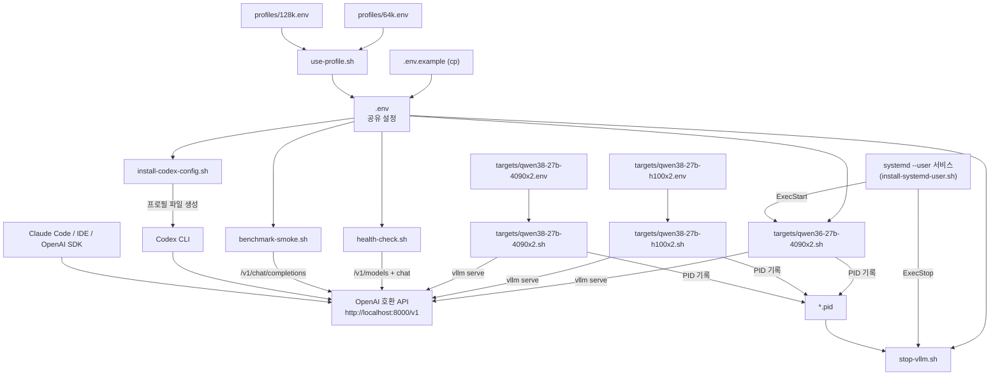

# 설계

핵심 패턴은 **"설정은 env 파일, 로직은 스크립트"** 입니다. 모든 스크립트는 시작 시 자기 설정 파일을 `set -a`로 로드하고 각 변수에 `${VAR:-default}` 기본값을 두므로, 설정 파일 없이도 내장 기본값으로 동작합니다.

## 설계 원칙

- **하드웨어 구성 하나 = 실행 스크립트 하나.** 조건 분기로 여러 하드웨어를 한 스크립트에 욱여넣지 않습니다. `targets/` 아래 스크립트는 서로 독립이고, 각자 자기 하드웨어에 맞는 기본값과 사전 점검을 들고 있습니다.
- **실행 전에 실패한다.** vLLM은 모델을 다 읽고 나서야 OOM으로 죽는 일이 잦습니다. 그래서 run 스크립트는 vllm 실행파일·GPU 개수·VRAM·compute capability·포트를 먼저 확인하고, 안 맞으면 원인과 해결 방법을 출력한 뒤 중단합니다.
- **수동 실행과 서비스 실행이 같은 코드 경로.** systemd 유닛은 run/stop 스크립트를 그대로 감싸기만 합니다.
- **종료는 이중 안전장치.** PID 파일 → 포트 리스너(`ss`) → 프로세스 목록(`ps`) 순으로 찾고 자식 워커까지 재귀 수집합니다. PID 파일이 날아가도 GPU 메모리가 물려 있는 상태로 남지 않습니다.

## 설정 파일이 두 갈래인 이유

레포 루트의 `.env`는 **공유 설정**입니다. `targets/qwen36-27b-4090x2.sh`, `use-profile.sh`, `health-check.sh`, `benchmark-smoke.sh`, `stop-vllm.sh`, 두 installer가 전부 이 파일을 봅니다.

Qwen3.8 타깃 두 개는 이 공유 파일을 읽지 않고 `targets/qwen38-27b-*.env`를 읽습니다. 공유 `.env`가 `MODEL=Qwen/Qwen3.6-27B-FP8`을 박아두고 있어서, 같이 읽으면 Qwen3.8 스크립트의 모델이 조용히 Qwen3.6으로 덮어써지기 때문입니다.

그 대가로 보조 스크립트는 공유 `.env`만 보므로, Qwen3.8 서버를 다룰 때는 값을 명령줄로 넘겨야 합니다.

```bash
PID_FILE=./vllm-qwen38-4090x2.pid PORT=8000 ./stop-vllm.sh
PORT=8000 SERVED_MODEL_NAME=qwen3.8-27b-fp8 ./health-check.sh
```

## 실행 흐름



## 경로 규칙

`targets/` 안의 스크립트는 두 경로를 구분합니다.

| 변수 | 가리키는 곳 | 쓰는 대상 |
|---|---|---|
| `SCRIPT_DIR` | `targets/` | 자기 타깃 전용 설정 파일 (`qwen38-27b-*.env`) |
| `REPO_ROOT` | 레포 루트 | 공유 자원 — `.env`, `.venv/bin/vllm`, `*.pid` |

PID 파일과 가상환경이 레포 루트에 모이므로, 어느 타깃을 띄웠든 `./stop-vllm.sh`와 `./health-check.sh`를 루트에서 그대로 쓸 수 있습니다.

## 별도 구성

`qwen3-coder-2080ti/`는 같은 패턴을 따르되 완전히 독립입니다. Turing(SM 7.5)이라 FP8을 못 써서 백엔드가 llama.cpp(기본, 포트 8080)와 vLLM(대안, 포트 8000) 두 갈래이고, 자체 `.env`·`health-check.sh`·`stop-server.sh`를 들고 있습니다. `health-check.sh`는 `BACKEND` 변수로 대상을 고릅니다.
